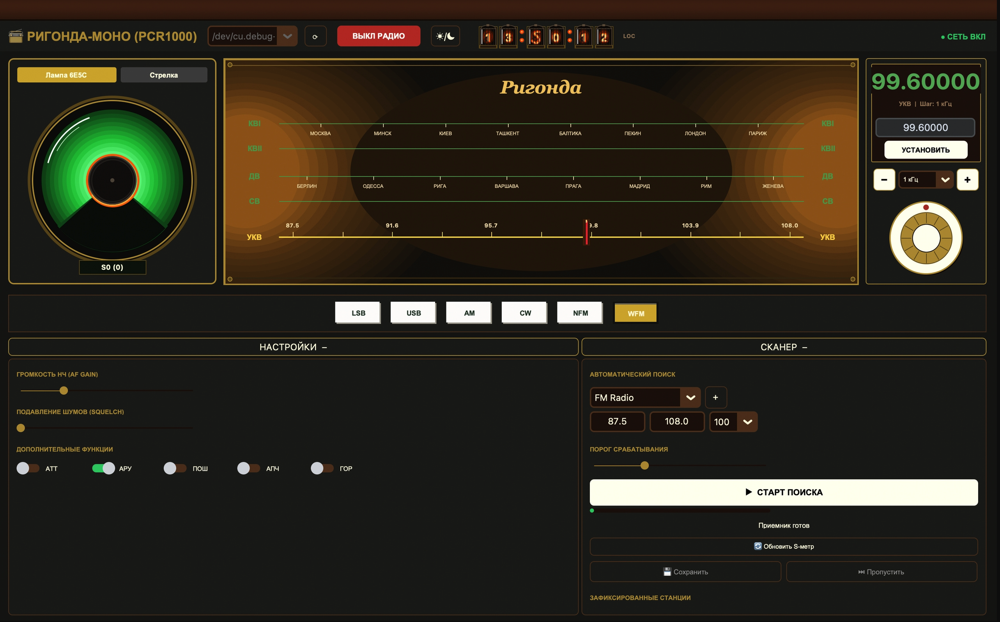

# Радиола «Ригонда-Моно» & Icom IC-PCR1000

Десктопное приложение на Python для управления связным приёмником **Icom IC-PCR1000** с интерфейсом в стиле советской ламповой радиолы «Ригонда».



## Возможности
* **Индикаторная лампа 6Е5С («Магический глаз»):** имитация плавного прогрева накала, свечения люминофора и инерции АРУ.
* **Стрелочный S-метр:** пружинная баллистика стрелки и тёплая ламповая подсветка циферблата.
* **Шкала настройки «Ригонда»:** дневная и ночная темы, подсветка боковыми лампами и перестройка частоты кликом или перетаскиванием визира.
* **Газоразрядные часы ИН-14:** индикация времени (ЧЧ:ММ:СС) с переключением Местное / UTC время по клику.
* **Управление IC-PCR1000:** выбор модуляции (клавиши П2К), полосы фильтра ПЧ, сдвиг ПЧ (IF Shift), индикатор точной настройки, АРУ, АТТ, ПОШ, АПЧ, VSC и автоматический сканер частот с экспортом в CSV.

## Установка и запуск

1. Клонируйте репозиторий и перейдите в папку проекта:
   ```bash
   git clone https://github.com
   cd pcr1000-rigonda
